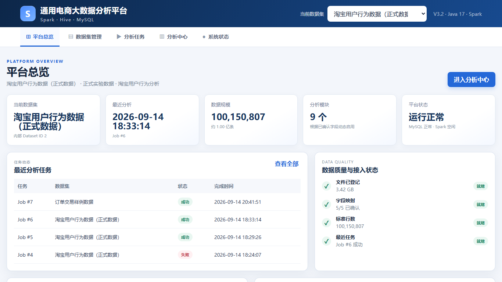
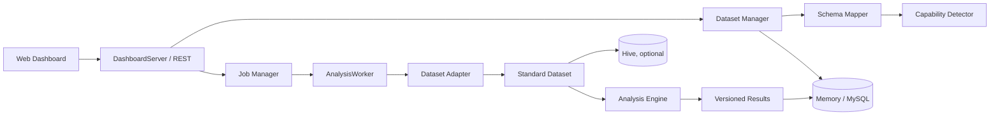

# Spark 电商行为分析平台

一个以 Java 17、Apache Spark 3.5 和原生 Web Dashboard 构建的电商数据分析项目。系统支持 CSV 数据集注册、字段映射、分析能力检测、异步任务、结果版本管理，以及可选的 MySQL 元数据持久化和 Hive 分层建模。

> 仓库只包含可公开演示的小型样例数据。原始大数据、运行日志、数据库文件、任务结果和本地凭据均不纳入版本控制。



## 项目亮点

- 统一数据接入：支持淘宝行为格式和通用 CSV，通过字段映射适配行为、订单两类数据。
- 可解释的能力检测：根据已确认的标准字段，只开放当前数据集真正可执行的分析模块。
- 隔离的任务执行：分析任务在独立 Spark 进程中运行，并保存状态、日志和不可覆盖的结果版本。
- 双层存储：MySQL 保存平台元数据；Hive 可保存按 `dataset_id` 隔离的标准模型。
- 可视化交付：内置 REST API 和中文 Dashboard，覆盖数据集、任务、分析结果与系统状态。

## 架构



详细设计见 [系统架构](docs/ARCHITECTURE.md)、[数据模型](docs/DATA_MODEL.md) 和 [数据库设计](docs/DATABASE_DESIGN.md)。

## 技术栈

- Java 17、Maven
- Apache Spark Core / SQL / Hive / MLlib 3.5.0
- JDK `HttpServer`、REST/JSON
- MySQL 8（可选）
- Apache ECharts 5.5.0
- JUnit 5

## 快速开始（Windows）

### 1. 环境要求

- JDK 17
- Maven 3.9+
- Windows 本地运行 Spark 时需要可用的 Hadoop `winutils.exe` 与 `hadoop.dll`
- MySQL 8 仅在启用持久化模式时需要

### 2. 运行测试

```powershell
.\scripts\test-v3.ps1 `
  -JavaHome 'C:\Program Files\Java\jdk-17' `
  -HadoopHome 'D:\Environment\hadoop-3.3.6'
```

也可以在 `spark` 目录中使用 Java 17 直接运行：

```powershell
mvn test
```

### 3. 启动内存模式

```powershell
.\scripts\start-v3.ps1 `
  -Repository memory `
  -Port 8090 `
  -JavaHome 'C:\Program Files\Java\jdk-17' `
  -HadoopHome 'D:\Environment\hadoop-3.3.6'
```

浏览器访问 `http://127.0.0.1:8090/platform.html`。仓库中的 `sample-data/` 可用于功能演示。

### 4. 启用 MySQL（可选）

1. 执行 `sql/v3_mysql.sql` 创建表结构。
2. 参考 `config.example.ps1`，只在当前终端设置真实连接信息。
3. 使用 `-Repository mysql` 启动服务。

完整参数、Hive 模式和生产边界见 [部署说明](docs/DEPLOYMENT.md)。

## 分析能力

平台当前覆盖数据质量、总览指标、行为分布、转化漏斗、时间趋势、商品/品类、用户活跃度和用户分群等模块。具体模块会根据数据集类型和字段映射动态启用，详见 [分析模块](docs/ANALYSIS_MODULES.md)。

## 可验证成果

- 2026-10-12 本机复测：Java 17 / Maven，`PlatformCoreTest` 共 4 项，4 项通过，0 失败，0 错误。
- 本次复测证据：[本地验证记录](docs/VERIFICATION_2026-10-12.md)
- 自动化测试入口：`scripts/test-v3.ps1`
- 核心测试代码：`spark/src/test/java/com/uni/platform/PlatformCoreTest.java`
- 历史测试证据：[测试报告](docs/TEST_REPORT.md)
- 12 个页面状态与浏览器验收记录：[UI 验收](docs/UI_ACCEPTANCE_V3_2.md)
- 功能截图：`docs/screenshots/v3.2/`

历史报告记录的是既有验收环境中的结果，不等同于对任意机器或任意数据规模的性能承诺。仓库不虚构吞吐量、耗时或资源指标。

## 数据与安全

- 不提交原始亿级数据；`data/` 已在根目录 `.gitignore` 中排除。
- 不提交 `runtime/`、`output/`、`target/`、Spark/Hive 本地仓库、Derby 日志或 IDE 私有状态。
- 数据库密码只通过 `PLATFORM_JDBC_PASSWORD` 环境变量提供。
- 默认监听 `127.0.0.1`。当前版本未实现身份认证，不应直接暴露到公网。
- 上传文件上限可通过 `platform.upload.max.bytes` 调整，默认 512 MiB。

## 项目结构

```text
SparkEcommerceAnalysis/
├─ sample-data/       # 可公开的小型演示数据
├─ scripts/           # 启动、测试与浏览器验收脚本
├─ spark/             # Maven / Spark 主工程
├─ sql/               # MySQL 与 Hive 建表脚本
├─ docs/              # 架构、接口、部署与验收文档
├─ config.example.ps1 # 无真实凭据的配置示例
└─ THIRD_PARTY_NOTICES.md
```

## 许可说明

项目源代码尚未选择开源许可证。在仓库保持私有时可继续内部使用；若计划公开，应先确认代码与数据权属并选择合适的项目许可证。第三方组件说明见 [THIRD_PARTY_NOTICES.md](THIRD_PARTY_NOTICES.md)。
