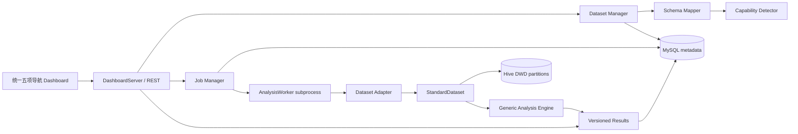

# V3.1 系统架构

## 架构原则

系统保持 Java 17 + Spark 的统一技术路线。现有 `DashboardServer` 基于 JDK `HttpServer` 增量提供 REST 与静态页面，不引入 Flask。若未来出现复杂鉴权、网关、事务编排或大量 API，再评估 Spring Boot。

## 分层职责

| 层 | 核心组件 | 职责 |
|---|---|---|
| 展示 | `platform.html/js/css` | 数据集、映射、任务、日志和分析结果展示 |

V3.2 将原七个顶层页面收敛为“平台总览、数据集管理、分析任务、分析中心、系统状态”。Dataset Detail、Mapping、Capability 和 Job Detail 作为页面内部工作区，不改变后端领域边界。Legacy 页面继续保留在 `/index.html`，但不再作为顶层入口，分析中心仅消费 V3 REST 结果。
| API | `PlatformApiHandler` | 路由、JSON、请求边界与统一错误响应 |
| 服务 | `PlatformService` | 组合数据集、能力、任务与结果查询 |
| 数据接入 | `DatasetManager`、`SchemaMapper` | 文件探测、注册、字段推荐和确认 |
| 能力 | `CapabilityDetector`、`AnalysisRegistry` | 从字段推导能力，再映射到可执行模块 |
| 计算 | `AnalysisWorker`、`GenericAnalysisEngine` | 独立 Spark 进程和标准模型分析 |
| 存储 | Hive、MySQL、版本目录 | 大表、元数据、任务状态和不可覆盖结果 |

## 关键数据流

1. Dataset Manager 只登记正式 CSV 的绝对路径和元数据。
2. Mapping 确认后数据集进入 `READY`。
3. Capability 根据标准字段决定可用分析模块。
4. Job Manager 先写入 `PENDING`，再启动独立 Maven/Spark Worker。
5. Worker 将源数据适配为行为或订单标准模型。
6. 启用 Hive 时，以动态分区覆盖写入当前 `dataset_id`，重试不会重复追加。
7. 每个模块写入独立 `dataset_id/job_id` 目录和 manifest。
8. Worker 成功后，MySQL 登记结果版本并将任务置为 `SUCCESS`。
9. REST analytics 只解析指定数据集和模块的 latest SUCCESS。

## 隔离与恢复

- 数据隔离：Hive 分区键 `dataset_id`。
- 执行隔离：每个任务独立 Spark 子进程。
- 结果隔离：`results/{dataset_id}/{job_id}`。
- 元数据持久化：正式模式只使用 MySQL，不静默回退内存。
- 失败恢复：任务保留 `FAILED`、退出码和日志；数据集恢复 `READY`，允许重试。
- 服务恢复：启动时把遗留 `PENDING/RUNNING` 标记为中断失败。
